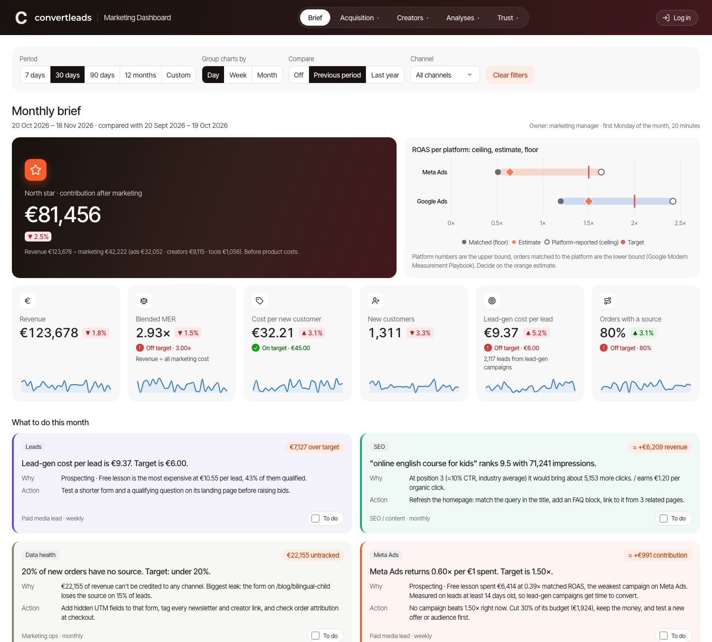
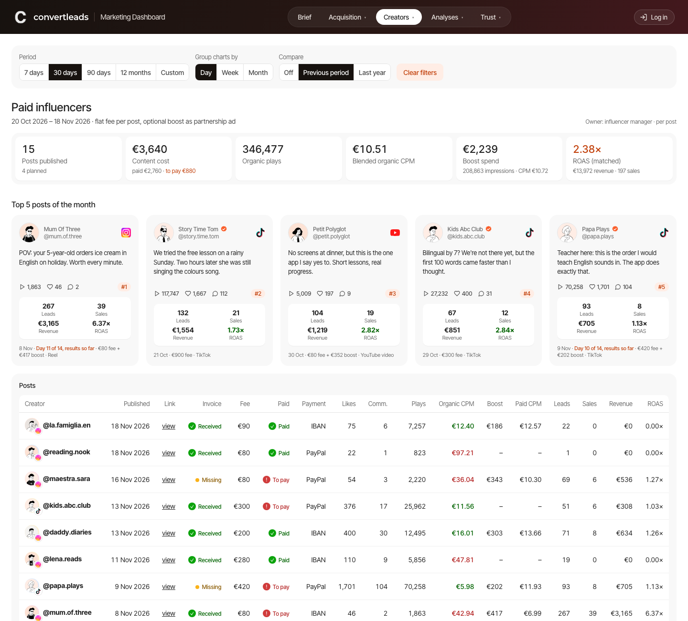

# Own-your-data marketing dashboard

A marketing dashboard that tells you what to do this week, not just what happened. Google Ads, Meta, GA4, Search Console, your shop, your CRM and your creators, on one screen. The data stays in one file on your own machine.

**Live demo:** https://ljkhgjvchf.github.io/own-your-data-marketing-dashboard/ (sandbox data, no login)



**Status:** v1 complete: 20 pages (Brief, Acquisition, Creators, Analyses, Trust). In the public demo, UGC, Ambassadors, Landing pages, Lead cohorts and Products are locked. It runs on sandbox data: 26 months of a fictional kids' language course. Live connectors (dlt) come in v0.2.



## Open it (30 seconds)

```bash
git clone https://github.com/ljkhgjvchf/own-your-data-marketing-dashboard.git
open own-your-data-marketing-dashboard/web/index.html     # no server, no account, no build
```

To rebuild the sandbox data: `python -m venv .venv && .venv/bin/pip install -r requirements.txt && .venv/bin/python seed.py && .venv/bin/python export.py`

## What's different from a normal dashboard

| Principle | Source | On screen |
|---|---|---|
| Never data without "so what" | Avinash Kaushik, *Action Dashboard* | The **Brief** writes up to 4 cards: what changed, why, what to do, € impact, owner |
| Platforms over-claim, matched sales under-count | Google, *Modern Measurement Playbook* | ROAS shown as a **range**: platform-reported (ceiling) · matched to real orders (floor) · estimate |
| Run the business on totals, channels inside channels | r/PPC practitioners | **Blended MER** and **cost per new customer** at the top |
| Short-term numbers miss brand | Binet & Field | **Share of search** next to SEO |
| One source of truth per metric | – | Leads = CRM, sales = shop orders, spend = ad platforms, traffic = GA4 |

## Pages

| Page | Answers |
|---|---|
| **Brief** | North star (contribution after all marketing cost), 6 KPIs vs target, up to 4 action cards with a completed tick, data health |
| **Acquisition · Overview** | New vs renewal revenue (click a bar for the sales), lead generation, CPL vs qualified-lead share, every funnel in one table, lead cohorts, top products |
| **Google Ads / Meta Ads** | Per campaign: the attribution rules, spend → revenue → ROAS, impressions → clicks → leads → sales, lead-dated vs sale-dated revenue, qualified split. Meta adds sales, hook rate and fatigue per creative |
| **Creators** | One creator sheet, five deal types. Overview: cost, matched revenue, ROAS, coupon-only sales, action cards, leaderboard. **Paid influencers:** posts with invoice / payment status, organic and paid CPM, leads, sales and ROAS per post, quotations with expected ROAS. **Affiliates:** 20% commission, owed vs paid, payouts, EPC. **UGC:** each asset joined to its Meta ad (hook rate, ROAS, fatigue). **Ambassadors:** posts agreed vs delivered, renewals from their buyers. **Partnerships:** pipeline board + results. **Content calendar:** month grid or list, posted vs planned, paid tick |
| **SEO & GEO** | Google: clicks, brand vs non-brand, share of search, quick wins valued at each page's own revenue per click. AI search: share of voice, mention and citation rate on ChatGPT, AI Overviews, Perplexity, Gemini and Claude, AI referral revenue, prompts a competitor wins. The 12 GEO checks of the `/audit-seo` skill with fixes. Website health: Lighthouse radar (mobile vs desktop) and Core Web Vitals |

| **Analyses** | **Channel funnel:** traffic → leads → sales share by channel, cost per sale. **Landing pages:** per-page traffic vs sales by source, purchase funnel. **Email:** every send with open rate (visibility), click-to-open (efficiency), leads, sales, € per 1,000, ROI; quadrant chart; send calendar; automated flows. **Lead cohorts:** sign-up month × months to purchase heatmap, 6-month payback per channel. **Products:** revenue by product, monthly-plan retention curve |
| **Trust** | **Data health:** share of orders and leads with a source, tracking checklist, where the source gets lost, data sources. **Experiments:** every test with lift, 95% confidence interval, p-value and decision (incl. a geo holdout for incrementality). **Definitions:** one meaning and one source of truth per metric |

Filters: period (7 days → 12 months, the Brief becomes a weekly / monthly / quarterly / yearly brief), chart grouping, compare with previous period or last year, channel, new vs renewal, product. Action cards can be ticked as completed (saved in your browser).

## How a sale gets its source

- **Lead-dated:** a lead from a campaign is matched by email to everything it buys afterwards, counted on the day it signed up.
- **Sale-dated:** an order with no lead before it is credited to the order's own UTM / click ID.
- **Coupon:** an order with no UTM but a creator's coupon goes to that creator (coupon-only). Link-only tracking misses these.
- **Never:** renewals, other platforms' click IDs, orders with no source. Those go to **Unattributed**, which the Brief flags above 20%.

`test_metrics.py` loads the dashboard script and checks its numbers against SQL on the DuckDB file.

## Files

```
seed.py          sandbox data → data/marketing.duckdb
export.py        DuckDB → web/data.js
web/             index.html · app.js · style.css · vendor/echarts (Apache-2.0)
test_metrics.py  python test_metrics.py
docs/ANALYSIS.md why the dashboard is organised this way
```

## Run-Without-Me Test

| | |
|---|---|
| Runs without me | ✅ open one HTML file |
| Data leaves your machine | ❌ never. No CDN, no tracking, no account |
| Licence | MIT (ECharts: Apache-2.0) |

Built by [Nicola Da Dalto](https://www.linkedin.com/in/nicoladadalto), AI marketing that works inside EU rules.
